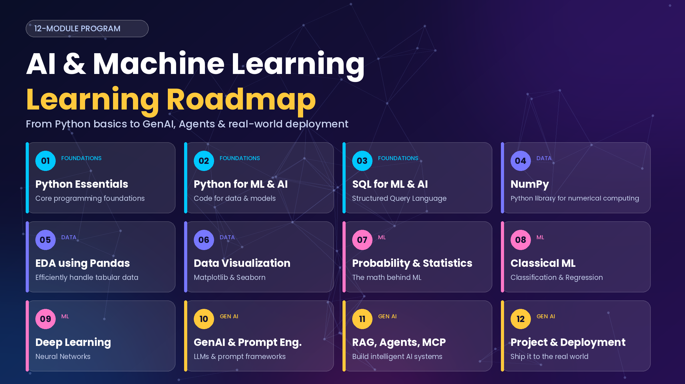

<p align="center">
  
</p>

<h1 align="center">AI & Machine Learning Learning Roadmap</h1>

<p align="center">
  <b>From Python basics to GenAI, Agents & real-world deployment</b>
</p>

<p align="center">
  
  
  
  
</p>

---

## 📖 About

This repository is a structured **12-module program** that takes you from writing your first line of Python to building and deploying intelligent AI systems with LLMs, RAG, Agents and MCP.

Each module has its own folder with notes, code and practice work, so you can learn step by step and track your progress.

## 🎨 Learning Tracks

| Track | Modules | Focus |
|-------|---------|-------|
| 🔵 **Foundations** | 01 – 03 | Python and SQL fundamentals |
| 🟣 **Data** | 04 – 06 | NumPy, Pandas, visualization |
| 🩷 **ML** | 07 – 09 | Statistics, classical ML, deep learning |
| 🟡 **Gen AI** | 10 – 12 | LLMs, RAG, agents, deployment |

## 🗺️ Roadmap

| # | Track | Module | What you'll learn | Progress |
|---|-------|--------|-------------------|----------|
| 01 | 🔵 Foundations | [Python Essentials](./01-python-essentials) | Core programming foundations | ⬜ |
| 02 | 🔵 Foundations | [Python for ML & AI](./02-python-for-ml-ai) | Code for data & models | ⬜ |
| 03 | 🔵 Foundations | [SQL for ML & AI](./03-sql-for-ml-ai) | Structured Query Language | ⬜ |
| 04 | 🟣 Data | [NumPy](./04-numpy) | Python library for numerical computing | ⬜ |
| 05 | 🟣 Data | [EDA using Pandas](./05-eda-using-pandas) | Efficiently handle tabular data | ⬜ |
| 06 | 🟣 Data | [Data Visualization](./06-data-visualization) | Matplotlib & Seaborn | ⬜ |
| 07 | 🩷 ML | [Probability & Statistics](./07-probability-and-statistics) | The math behind ML | ⬜ |
| 08 | 🩷 ML | [Classical ML](./08-classical-ml) | Classification & Regression | ⬜ |
| 09 | 🩷 ML | [Deep Learning](./09-deep-learning) | Neural Networks | ⬜ |
| 10 | 🟡 Gen AI | [GenAI & Prompt Eng.](./10-genai-and-prompt-engineering) | LLMs & prompt frameworks | ⬜ |
| 11 | 🟡 Gen AI | [RAG, Agents, MCP](./11-rag-agents-mcp) | Build intelligent AI systems | ⬜ |
| 12 | 🟡 Gen AI | [Project & Deployment](./12-project-and-deployment) | Ship it to the real world | ⬜ |

> Update the **Progress** column as you go: ⬜ Not started · 🟨 In progress · ✅ Completed

## 🧰 Tech Stack


## 📁 Repository Structure

```text
AI-ML/
├── assets/
│   └── AI_ML_Roadmap_Banner.png
├── 01-python-essentials/
├── 02-python-for-ml-ai/
├── 03-sql-for-ml-ai/
├── 04-numpy/
├── 05-eda-using-pandas/
├── 06-data-visualization/
├── 07-probability-and-statistics/
├── 08-classical-ml/
├── 09-deep-learning/
├── 10-genai-and-prompt-engineering/
├── 11-rag-agents-mcp/
├── 12-project-and-deployment/
├── requirements.txt
└── README.md
```

## 🚀 Getting Started

```bash
# 1. Clone the repository
git clone https://github.com/kaushal4445/AI-ML.git
cd AI-ML

# 2. Create a virtual environment
python -m venv venv
source venv/bin/activate        # Windows: venv\Scripts\activate

# 3. Install dependencies
pip install -r requirements.txt

# 4. Launch Jupyter
jupyter notebook
```

## 🧭 How to Use This Repo

1. **Follow the order.** Each module builds on the previous one.
2. **Code along.** Don't just read; run and modify every example.
3. **Practice.** Finish the exercises at the end of each module.
4. **Build.** Apply what you learn in mini projects before moving on.
5. **Track progress.** Tick off modules in the roadmap table above.

## 🎯 Final Outcome

By the end of the program you will be able to:

- Write clean Python and query data with SQL
- Analyze and visualize real-world datasets
- Build, evaluate and tune classical ML and deep learning models
- Design prompts and work with Large Language Models
- Build RAG pipelines, AI agents and MCP-based systems
- Deploy an end-to-end AI project to production

## 🤝 Contributing

Suggestions and improvements are welcome. Open an issue or submit a pull request.

## ⭐ Support

If this repo helps you, consider giving it a star on GitHub.

---

<p align="center">Made with ❤️ by <a href="https://github.com/kaushal4445">kaushal4445</a></p>
